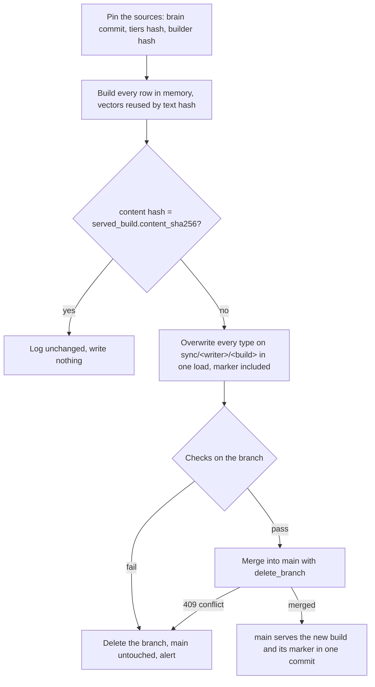

# RFC: Derived graphs are built whole on a branch, checked, merged once, and say which build they serve

> Status: **Proposed** · Date: 2026-10-26 · Epic: VIK-1259 (second brain) · Builds on the
> [Omnigraph runbook](../runbooks/omnigraph.md#company-view), the
> [branch workflow RFC](rfc-omnigraph-branch-workflow.md) and the
> [Omnigraph 0.14 and knowledge tiers RFC](rfc-omnigraph-014-and-knowledge-tiers.md) (section 7,
> the write rules)

> **TL;DR.** The company view (live since 2026-10-26) rewrites `company/main` every hour in
> several commits: deletes first, then loads. A reader between those commits sees a view that is
> half old and half new, a failed load leaves the deletes in place for up to an hour, and nothing
> in the graph says which build it is serving. This RFC proposes one pattern for a writer that owns
> a whole graph and can rebuild it from its sources: load the complete build onto the writer's
> own sync branch in one overwrite, run check queries there, merge into `main` in one step, and
> publish a `ServedBuild` marker row in the same merge, readable through a stored query
> `served_build`. A failed check deletes the branch and leaves `main` untouched. An unchanged
> build writes nothing. Leftover sync branches are deleted at server start, because a schema
> change is refused while a graph has any branch besides `main`. The company view goes first;
> the Forgejo importer is a possible second, in a weaker form, because it shares `brain` with
> writers that stay on `main`. The mechanics were measured on the pinned 0.14.0 CLI
> ([section 3](#3-what-omnigraph-014-does-measured)).

## 1. Why

What the company view does today ([company_view.py](../../../../kubernetes/apps/ai/omnigraph/company-view/app/company_view.py),
[apply.sh](../../../../kubernetes/apps/ai/omnigraph/company-view/app/apply.sh)), every hour at :10:

1. `plan` reads the brain's Forgejo projects, ADR notes and topic edges on `brain/main`, and the
   current `company/main`, and writes only the difference: delete statements in batches of 500
   (`prune-*.gq`) and merge-load files of 2,000 rows (`load-*.ndjson`).
2. `embed` fills `DecisionRecord.content` and `Topic.name` vectors for the rows it is about to write.
3. `apply` runs every delete batch, then every load batch, each its own commit on `company/main`.

That is correct eventually and wrong in between:

| Problem | Where it shows |
|---|---|
| **Half-applied state is served.** A relinked record has its edges deleted in the prune commit and reloaded in the load commit. Between the two, `records_about` and `repositories_about` miss it | The live run of 2026-10-26 15:10 had `relinked=8` and `deleted=4`: one delete commit, one load commit |
| **A failed run leaves the deletes.** If a load batch is refused, the deletes already landed, and readers see a thinner view until the next hour replans | `apply.sh`: "the next run replans from the graph" |
| **Reads of the source are not pinned.** `plan` sends eight queries to `brain/main` while the vault importer, the Forgejo importer and the distiller write it, so one build can mix two brain commits | `BRAIN_QUERIES` in `company_view.py` read `branch: main` without a snapshot |
| **Nothing says what is served.** A reader cannot tell which brain commit, which tier list or which builder produced the rows, or when | No marker; only job logs, kept 7 days |
| **No rollback to a known build.** Undoing a bad run means fixing the cause and waiting an hour | — |
| **"Behind" is invisible.** `OmnigraphCompanyViewFailing` fires on refused runs, but a job that silently stops changing anything, or a source that stops moving, raises nothing | [vmrule.yaml](../../../../kubernetes/apps/ai/omnigraph/company-view/app/vmrule.yaml) |

The company view is the easiest place to fix this, because it owns its graph alone. Its policy
([company.policy.yaml](../../../../kubernetes/apps/ai/omnigraph/app/bundle/company.policy.yaml))
gives `change` to the `builders` group (`act-company-view`) and to the admins; no agent, importer or
person writes `company` in normal operation. Everything in it is derived: repositories and decision
records from the Forgejo importer's `forge/*` rows (themselves rebuilt from Forgejo every hour),
topics from the distiller, filtered by the tiers in OpenBao. So the whole graph can be rebuilt at
any time, and a rebuild is the natural unit to publish.

Size, from the job log of 2026-10-26: 50 repositories, 276 decision records and 1,834 topics, plus
their edges. Every type is far below the 8,192-row commit limit.

## 2. The pattern

For a writer that owns a graph (or a namespace, [section 6](#6-coexisting-with-writers-that-stay-on-main))
and can derive its rows from pinned sources:

1. **Pin the sources.** Read the source graph's head commit once (`graph_commit_id` comes back with
   the first query) and send every further source read with that `snapshot`; brain-tools and the
   eval already do this. Hash the tier list (defaults plus the OpenBao overrides) and the builder
   (`company_view.py`). The build id is the hash of the three.
2. **Build whole.** Produce every row of every type the writer owns, in the order nodes, then edges.
3. **Reuse vectors by content hash.** Read the served rows with their vectors (a query may return a
   `Vector(384)` property with `read` alone, measured). Hash the exact text the embedding contract
   would embed (`type: <Type>\n<field>: <value>`, trimmed per the contract). A row whose text hash
   matches a served row takes that vector; only new or changed text goes to the embed step. No
   schema property is needed, because the hash is recomputed from the served text.
4. **No-op.** Hash the build's rows, vectors left out, in a canonical order. When that equals the
   served marker's `content_sha256`, log `company view unchanged` and stop: no branch, no commit.
   The decision is on the content, not the source commit: `brain` moves several times an hour (the
   vault importer every 15 minutes, the distiller, chat captures) for reasons that rarely touch the
   view, so a source-revision rule would rebuild most hours for nothing.
5. **Load onto a sync branch.** `POST /graphs/company/load/ndjson?mode=overwrite&branch=sync/company-view/<build12>`
   with `from=main`, in **one** request holding every node type, every edge type and the marker.
   Overwrite replaces exactly the types present in the request and validates referential integrity
   before it publishes, so the old rows of those types go and the new ones arrive in one branch
   commit. One request is a requirement, not a convenience: overwriting a node type in one request
   and its edges in another is refused (`__dst 'repo/…' not found in Repository`, measured), and a
   second overwrite of the same type would erase the first. Today's build is about 9 MB with
   vectors (a synthetic build of the same size, measured); the served request limit is 32 MiB.
6. **Check on the branch.** Every check reads `branch=sync/…`:
   - row counts per type equal the build manifest;
   - required keys: every `Repository` has `url` and `status`; every `DecisionRecord` has exactly one
     `RecordOf` edge to a repository in the build; every `Topic` has at least one `RecordAbout` or
     `RepositoryAbout` edge;
   - `vectors_missing` (rows with text and no vector) equals what the embed step reported;
   - every stored query of [company-view.gq](../../../../kubernetes/apps/ai/omnigraph/app/bundle/company-view.gq)
     answers on the branch, and the ones that must find something do (`company_repositories` and
     `recall_records` return rows, `decision_record` of a known slug returns one);
   - a deletion guard: the branch diff against `main` (`GET /branches/diff`) deletes at most 20% of
     the served rows unless the tier hash changed. Today the only guard is "the brain shows no
     Forgejo projects"; this one also catches a source that lost half its rows.
7. **Merge once.** `POST /branches/merge` with `delete_branch: true`. The receipt names the commit
   that now serves the build. A refused check or a refused merge deletes the branch and exits
   non-zero; `main` never saw any of it.
8. **The marker.** One `ServedBuild` row, always the slug `served`, travels in the same load and
   therefore in the same merge as the rows it describes, so it cannot claim a build that is not
   being served:

   | Property | Value |
   |---|---|
   | `slug` | `served` (`@key`) |
   | `writer` | `company-view` |
   | `build_id` | hash of the three pinned inputs |
   | `source_revision` | the brain commit the build read |
   | `tiers_sha256`, `builder_sha256` | the other two inputs |
   | `content_sha256` | the no-op key |
   | `applied_at` | the time the branch load was made (`DateTime`, second precision); the merge receipt's `created_at` is logged beside it |
   | `rows`, `vectors_missing` | totals; per-type counts go to metrics |

   `served_build()` is a stored query in `company-view.gq` returning that row. Staff keys, the
   explorer and the laptop CLI read it; agents can answer "how fresh is this?" from the graph
   itself.

**Drain at server start.** A schema change to a graph is refused while that graph has any branch
besides `main`; on 0.14, [next/bootstrap.sh](../../../../kubernetes/apps/ai/omnigraph/app/next/bootstrap.sh)
then keeps serving the old bundle and `OmnigraphBundleNotApplied` fires. A sync branch is only left
behind when a run dies between load and merge (deadline, node loss, pod restart). Two sweeps cover
it: the writer deletes every `sync/<writer>/*` branch before it loads, and the bootstrap deletes
every `sync/*` branch of every graph before `cluster plan`. Deleting a sync branch loses nothing,
because its content is rebuilt by the next run. The bootstrap never touches any other prefix
(`glide/*`, `ingest/*`, `preview/*`). The bootstrap runs before the server admits requests, so no
writer can create a branch during the drain.

## 3. What Omnigraph 0.14 does, measured

Run on 2026-10-26 with the 0.14.0 CLI from mise (`mise install github:ModernRelay/omnigraph@0.14.0`)
on throwaway standalone graphs initialised with `company-view.pg`, in a scratch directory. No
homelab graph was touched.

| Test | Result |
|---|---|
| `load --mode merge` of 9,000 `Topic` rows to `main` | **413** `payload_too_large`, `resource_limit` 8,193 of 8,192, `disposition.effects: none` |
| The same 9,000 rows in two merge loads (8,000 + 1,000) | Two commits, both published |
| `load --mode overwrite --branch sync/b2 --from main` with 9,000 rows (100 removed, 100 new, 890 renamed) | One commit on the new branch; the direct engine's overwrite is not bound by the 8,192 keyed-load limit |
| `branch diff sync/b2 --into main` | Exactly 890 updates, 100 inserts, 100 deletes: rows rewritten with identical values are not reported |
| `branch merge sync/b2 --into main --delete-branch` | `fast_forward`, branch deleted, receipt with the published commit |
| A fresh branch overwritten with 9,000 changed rows while `main` gained an unrelated row, then merged | `merged` in one step; no row limit on the merge |
| The same, but `main` edited one `Topic` the branch also rewrote | **409** `divergent_update` on that row; nothing published; the branch stays |
| Overwrite `Repository` alone on a branch while `RecordOf` edges still point at a repository the batch drops | Refused: `__dst 'repo/w/r0' not found in Repository`; nothing written |
| A company-sized build (50 repositories, 276 records of about 4,200 characters, 1,834 topics, 1,104 edges, every embedded row with a 384-float vector) | 9.4 MB of NDJSON; loads as one overwrite |
| Disk use of that graph after 1, then 6 identical overwrites, then 5 identical merge loads | 3.6 MB, 21.0 MB, 39.7 MB: **every full write adds about 3.5 MB of table versions, overwrite and merge alike**, until `cleanup` |
| `query` returning `$d.embedding` | Returns the stored vector; `read` is enough |

Not measured, and phase 0 below measures it before any code changes: the same flow through
`omnigraph-server` over HTTP (`/load/ndjson` with `mode=overwrite` caps the body and its decoded
Arrow memory at 32 MiB), the server's merge receipt and conflict body, and a bundle with a new node
type planned while a sync branch is open, then drained.

## 4. What it buys

- **Readers never see half-applied state.** One merge publishes every change of a run, the marker
  included. The two-commit window of today disappears.
- **A failed run changes nothing.** Today a refused load leaves the deletes. Under the pattern a
  refused load, check or merge leaves `main` exactly as it was, and the alert says which.
- **Provenance.** `served_build` names the brain commit, the tier hash and the builder that produced
  what is being read, and when. A wrong row can be traced to its input without reading job logs.
- **Rollback by rebuilding an older build.** A build is a pure function of its three inputs, so
  `company_view.py build --source-revision <brain commit>` produces an older build again and the same
  branch, check and merge path publishes it atomically. This works for as long as the brain keeps
  that commit (`cleanup --older-than 7d` in the bootstrap, so a week). The tier list is taken as it
  is now unless one is given; the marker records which was used.
- **Alerts on the right things.** "Behind" and "failing" become metrics the writer pushes, not log
  lines: see [section 7](#7-monitoring).
- **Fewer write paths.** The prune files, the relink bookkeeping and the merge-load diff go away for
  the company view: overwrite deletes whatever the build does not contain.

## 5. What it costs

- **Disk.** A changed run rewrites every row of the graph instead of the changed few: about 3.5 MB of
  table versions per changed run at today's size (measured), against a few kilobytes today. The
  no-op rule keeps unchanged hours at zero. If every hourly run changed something, that is about
  84 MB a day, bounded at about 0.6 GB by the 7-day `cleanup`; on the 20Gi `omnigraph-014-state`
  volume that is acceptable, and `PVCVolumeFillingFast` watches it. It is the trade-off of question
  Q2.
- **Grants.** `act-company-view` needs, on `company` only: `change` on unprotected branches (today it
  has `change` on `protected` only), `branch_create`, `branch_delete`, `branch_merge` with
  `target_branch_scope: any`, and `invoke_query` for the stored-query check. The policy cannot pin a
  branch prefix, so the writer could write any unprotected branch of `company`; it is the graph's only
  writer, so that widens nothing another actor depends on. `act-gitops` needs `branch_delete` on every
  graph for the drain.
- **A schema change, once.** `ServedBuild` and `served_build` are additions to `company-view.pg` and
  `company-view.gq`: a new node type applies in place, and `company` has no branches today.
- **Branch discipline.** Two sweeps (writer and bootstrap) and an alert for a sync branch older than
  two hours. A sync branch that is never cleaned is the one way this pattern can block a schema
  change.
- **An extra step per run.** A branch load, a handful of check queries and a merge instead of two
  writes on `main`: seconds.
- **Review mode and the branch monitor.** The review container's graph list is
  `OMNIGRAPH_REVIEW_GRAPHS=brain,memory,webgrip`, so company sync branches are invisible to the
  inbox, to `omnigraph_branches_open`, to `OmnigraphBranchesPileUp` and to the 14-day sweeper. For the
  company view that is right: a sync branch is never reviewed by a person. For a sync branch on
  `brain` ([section 6](#6-coexisting-with-writers-that-stay-on-main)) the explorer must learn a `sync`
  prefix that is excluded from the inbox and from `OmnigraphBranchesPileUp` (whose `prefix!="preview"`
  filter would otherwise count it as `other`), and the stale-sync alert below replaces the 3-day
  backlog alert for it. That is a change in the `omnigraph-explorer` repository, needed only for
  phase 3.
- **The startup vector backfill.** The bootstrap fills vectorless rows on `main` of every graph with
  `omnigraph embed`, which embeds raw text, while the writers embed the contract's prefixed text (the
  0.14 RFC, T1.8). With vector reuse from `main`, a backfilled raw vector would be reused forever,
  and a backfill write to a row the next build changes is a `divergent_update` that refuses the
  merge (measured). The company view embeds its own rows and heals the ones its embed step skipped,
  so the backfill should skip writer-owned graphs (question Q4).

## 6. Coexisting with writers that stay on `main`

The pattern needs one owner per row set. It does not replace the slug namespaces of the
[branch workflow RFC](rfc-omnigraph-branch-workflow.md#61-who-owns-which-rows); it relies on them.

| Graph | Writers | Fit |
|---|---|---|
| `company` | `act-company-view` alone (admins by hand, the bootstrap's backfill) | **Full pattern.** The writer owns every type, so overwrite per type is safe. Any write to `company/main` outside the builder conflicts at most once and is then overwritten by the next build: the builder owns the graph, and a hand edit belongs in its source (the ADR, the tier list) |
| `brain`, `forge/*` rows | `act-forge-import` | **Branch, check, merge, without overwrite.** `Note`, `Artifact`, `Passage`, `Project`, `Person` and `Organization` also hold `obsidian/*`, `nt-*`, `derived/*` and hand-written rows, and a mutation cannot delete by prefix (a delete predicate takes comparison operators only, a 0.11 limit in the runbook not re-tested on 0.14), so overwrite would erase other writers' rows. The importer keeps its diff planner and applies the diff on `sync/forge-import/<run>`, then merges once |
| `brain`, everything else | vault importer (every 15 minutes), distiller, `act-brain-agent`, `act-brain-scribe`, the backfill | **Stay on `main`.** They write small increments; a branch every 15 minutes would only churn branches |
| `memory`, `webgrip`, tenant graphs | agents, ingest, ploegd | Out of scope; reviewed writers use branches or proposals already |

What the Forgejo importer would gain: one atomic publish per run (an artifact, its passages and its
edges appear together; a refused batch no longer leaves half a repository), the pinned-snapshot
reads, an `ImportRun` marker (`served_build` on `brain`), and the deletion guard. What it would risk:
a merge into a `main` that other writers changed during the run. Under the namespace rule they write
other rows, so the three-way merge is clean, with two exceptions measured or known:

- the backfill or a person filling a vector on a `forge/*` row the run also rewrote:
  `divergent_update`;
- the distiller adding a topic edge to a `forge/*` artifact the run deletes: `orphan_edge`.

Both make the merge refuse whole, and the next run, which plans against the new `main`, normally goes
through. Phase 3 therefore starts in shadow mode: build the branch, `POST /branches/merge` with
`dry_run: true`, delete the branch, write nothing, and count conflicts for a week before any switch.

The schedules already separate the writers (`company-view` :10, vault :05/:20/:35/:50,
`forge-import` :40, distiller :55), and with pinned reads the company view no longer cares which of
them lands during its run.

## 7. Monitoring

The writer pushes, per graph and writer, to vmagent (as the embed step does, `job="omnigraph-build"`):

| Series | Meaning |
|---|---|
| `omnigraph_build_runs_total{graph,writer,outcome}` | `merged`, `unchanged`, `check_failed`, `conflict`, `refused` |
| `omnigraph_build_last_success_timestamp_seconds{graph,writer}` | Last run that ended `merged` or `unchanged` |
| `omnigraph_build_served_timestamp_seconds{graph,writer}` | `applied_at` of the served marker |
| `omnigraph_build_source_lag_seconds{graph,writer}` | The age of the source commit the last successful run read, at the time it ran |
| `omnigraph_build_rows{graph,writer,type}`, `omnigraph_build_vectors_missing{graph,writer}` | The served build |

| Alert | Condition | Why |
|---|---|---|
| `OmnigraphBuildStale` | No `merged` or `unchanged` run for 3 hours | The view is behind its sources, whatever the reason; replaces "is the CronJob succeeding" as the question |
| `OmnigraphBuildCheckFailing` | Two runs in 3 hours ended `check_failed` or `conflict` | The source or the graph is in a state the writer refuses to publish |
| `OmnigraphSyncBranchStale` | A `sync/*` branch older than 2 hours (the writer reports what its sweep found and deleted, the bootstrap logs what it drained) | The one thing that can block a schema change |

"Behind Forgejo" for the company view is the chain of two writers: the Forgejo importer's own
`OmnigraphForgeImportStale` plus `OmnigraphBuildStale`. A direct comparison with Forgejo's latest
push time belongs to the importer once it carries a marker (phase 3).

`OmnigraphCompanyViewFailing` and `OmnigraphCompanyViewUntieredRepository` stay; the untiered verdict
is unchanged.

## 8. Phased plan

| Phase | Delivers | Verification |
|---|---|---|
| P0 | Measure the served path on a local `omnigraph-server` 0.14.0 with the real bundle: overwrite through `/load/ndjson`, merge receipt and 409 body over HTTP, `dry_run`, a new node type planned with a sync branch open (refused, old bundle served), the bootstrap drain, then planned again (applied) | A script in `scripts/` like the existing real-server tests, kept as the regression test |
| P1 | `ServedBuild` + `served_build` in the company bundle; the policy grants; `company_view.py` pins its reads, builds whole, reuses vectors, checks, merges, writes the marker, pushes the metrics; behind `--publish=branch` with `--publish=direct` (today's path) as the default for one week, then flipped | `test_omnigraph_company_view.py` against the simulated graph plus the P0 real-server script; the mutation test gains a case per check; live: `served_build` answers and a no-op hour writes no commit |
| P2 | The bootstrap drains `sync/*`; the three alerts; the backfill skips writer-owned graphs | The bootstrap rehearsal gains a case with a leftover sync branch and a schema change: drained, then applied |
| P3 | Forgejo importer: shadow mode for a week (branch, `dry_run` merge, delete), then the switch if conflicts are rare; explorer learns the `sync` prefix | Shadow-mode conflict count; review inbox shows no sync branch |

## 9. Alternatives considered

| Option | Why not, or not yet |
|---|---|
| Keep writing `main` directly (today) | Section 1 |
| **One overwrite load straight onto `company/main`**, marker included | The smallest change, and it is atomic too: one request, one commit, referential integrity checked before publication. What it loses is checking before publishing: the build files can be checked locally (counts, keys), but not whether the stored queries still answer on the engine, and the deletion guard has no diff to read. It is the fallback if P0 finds the branch path unworkable (question Q1) |
| A second graph `company-next`, swapped | Omnigraph has no graph alias; every stored-query caller names the graph, so a swap is a config change in each reader |
| Unpublished commits (`branch merge … as commit`, then `commit publish`) | Still needs the branch to build on; adds a publish step without removing anything. Useful later for a person approving a build, not for an automatic writer |
| Diff loads on the branch instead of overwrite (keep today's planner) | Writes kilobytes instead of megabytes per changed run, but keeps the delete bookkeeping and its failure modes. The right mode for `brain` (section 6), and the fallback for `company` if disk growth bites (question Q2) |
| `@key`-only idempotent merge loads without deletes | Cannot remove a repository that left the internal tier |

## 10. Open questions

Each has a recommendation; none blocks P0.

1. **Branch or single overwrite on `main` for the company view?** The branch adds checks before
   publishing and a diff for the deletion guard; the single overwrite is one call with nothing to
   drain. *Recommendation:* branch, as decided on 2026-10-26, with the single overwrite kept as the
   fallback should P0 show the served path cannot do it.
2. **Overwrite or diff on the branch?** Overwrite: 3.5 MB per changed run, about 0.6 GB worst case
   inside the 7-day cleanup, no delete bookkeeping. Diff: kilobytes, today's planner, more code.
   *Recommendation:* overwrite for `company`; revisit when the build passes 24 MiB (the 32 MiB request
   limit with headroom) or the volume's growth alert fires.
3. **What makes a run a no-op?** Content hash (vectors excluded) or source revision. *Recommendation:*
   content hash; the source revision is recorded but moves several times an hour for
   reasons that do not touch the view.
4. **Should the startup backfill skip writer-owned graphs?** Skipping avoids raw-format vectors being
   reused and a backfill write conflicting with the next merge; the cost is that a row the embed step
   left vectorless waits for the next hourly run instead of the next restart. *Recommendation:* skip
   `company` (an `OMNIGRAPH_BACKFILL_SKIP_GRAPHS` list in the bootstrap), and decide for `brain` in P3.
5. **Rollback: rebuild from a pinned source, or archive builds?** Rebuilding needs no store and works
   within the 7-day history; archiving the 9 MB build files to Garage would allow any older build but
   adds a bucket, keys and a retention rule. *Recommendation:* rebuild; archive only if a rollback older
   than a week is ever needed.
6. **How strict is the deletion guard?** 20% of served rows unless the tier hash changed.
   *Recommendation:* start there, log the observed share per run for a month, then tighten.
7. **Who may write `company/main` besides the builder?** Admins keep `change` for emergencies, but any
   hand edit is overwritten by the next build. *Recommendation:* keep the grant, document in the runbook
   that `company` is rebuilt from its sources and fixes go to the source.
8. **Forgejo importer: shadow mode first, or not at all?** Its gain is atomic publication of an import;
   its risk is merge refusals from other writers. *Recommendation:* shadow mode for a week after P2, and
   switch only if fewer than one run in twenty would have been refused.
